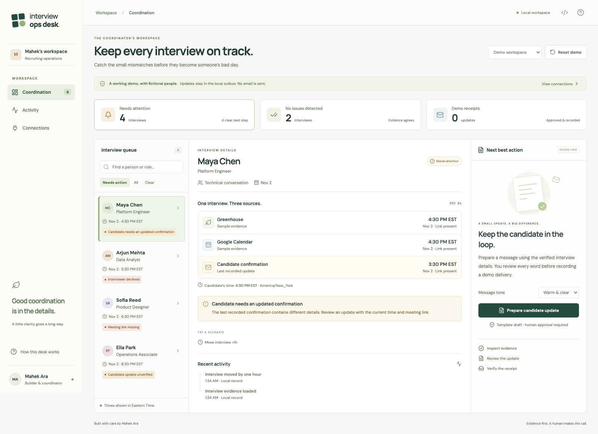
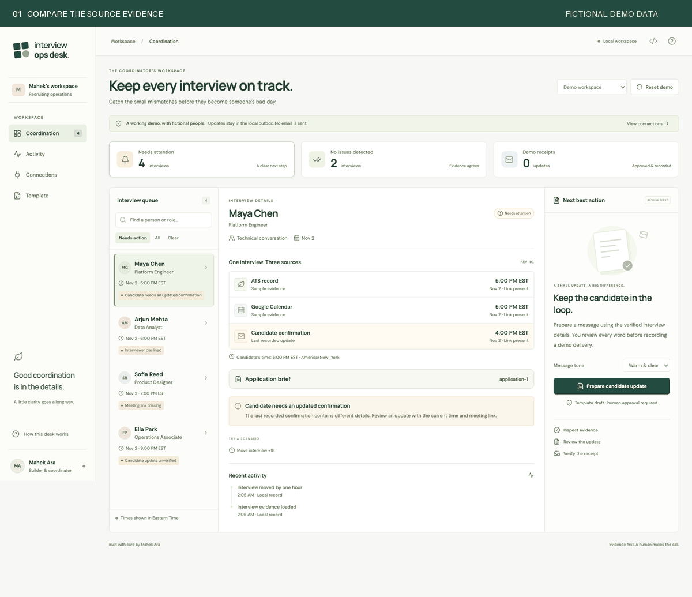
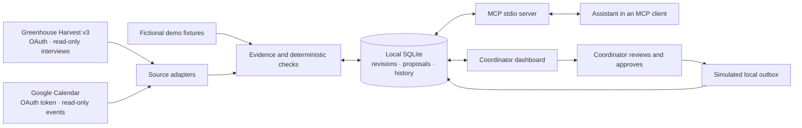

<p align="center"></p>
<h1 align="center">Interview Ops Desk</h1>
<p align="center"><strong>Keep every interview on track.</strong><br/>Compare the evidence. Review the update. Follow through to a receipt.</p>
<p align="center"><a href="#try-it-locally">Run the demo</a> · <a href="docs/CONNECTIONS.md">Connect Greenhouse & MCP</a> · <a href="docs/CASE-STUDY.md">Read the case study</a></p>
<p align="center"><a href="https://github.com/mahekara28/interview-ops-desk/actions/workflows/ci.yml"></a>   </p>



An interview moves by an hour. The calendar and ATS agree, but the last recorded candidate confirmation still contains the old time. Interview Ops Desk makes that mismatch visible, prepares a clear update and keeps the approval, failure and recovery in one place.

This is a local working prototype by **Mahek Ara**. The default workspace uses six fictional interviews. Its outbox records simulated receipts; it sends no external email. The Greenhouse and Google Calendar adapters are implemented and contract-tested, but have not been validated against a live account.

## Try it locally

Use Node.js 24 or newer. No API keys are needed for the demo.

```sh
git clone https://github.com/mahekara28/interview-ops-desk.git
cd interview-ops-desk
npm ci
npm run build
npm start
```

Open **http://127.0.0.1:4310**. The app listens on loopback only. `npm run dev` runs the development server at the same address. Local state persists in `.data/desk.sqlite`; Reset demo clears only the fictional workspace.

### The 90-second walkthrough

1. Open **Maya Chen**. Compare Greenhouse, Calendar and the last candidate confirmation.
2. Select **Prepare candidate update**. Review the template and its named time zone.
3. Enable **Simulate a delivery timeout**, then approve the demo delivery.
4. Retry the approved message. Inspect the local receipt and the now-consistent evidence.
5. Open **Activity** to see the proposal, coordinator approval, simulated failure and recovery.

<picture><source media="(prefers-reduced-motion: reduce)" srcset="docs/images/desk-overview.png"/></picture>

The walkthrough uses captured UI states from the browser tests. It is a demonstration of local behavior, not a recording of a real recruiting account.

## Where Greenhouse and MCP fit



**The API connects the source systems.** Harvest v3 supplies scheduled interview records; the adapter matches `external_event_id` to a Google Calendar event. Authorized OAuth credentials are required. Greenhouse is never accessed through browser scraping or through a job-seeker login.

**MCP exposes this desk to an assistant.** The assistant can inspect the evidence and prepare a proposal in the same database the UI reads. It cannot approve a delivery, send an email or edit Greenhouse. MCP itself is neither an LLM nor a replacement for API credentials. The host application supplies its model; this prototype uses deterministic checks and template drafts without calling a model API.

In **Connections**, use **Copy MCP configuration** for the exact local paths. See the [setup guide](docs/CONNECTIONS.md) for scopes, supported records, configuration and limits.

| MCP tool                    | What it does                                             |
| --------------------------- | -------------------------------------------------------- |
| `list_interview_cases`      | Lists coordination issues in one workspace               |
| `inspect_interview`         | Returns source evidence, revision, proposal and activity |
| `prepare_candidate_update`  | Creates a local template draft for dashboard review      |
| `get_coordination_activity` | Reads the audit trail                                    |

Example assistant request: “Inspect the cases that need attention. Prepare an update for the first candidate whose source records agree. Explain what the coordinator should verify.”

## What works

- A searchable queue, source comparison, named time zones and a separate activity view.
- Checks for stale confirmations, missing calendar evidence, source mismatches, declined participants, cancellations and missing meeting links.
- Editable drafts with required evidence fields; approval tied to an interview revision.
- Persistent demo delivery failure and recovery. Repeated delivery requests return the original receipt.
- Real MCP stdio tools sharing the same SQLite store with the dashboard.
- Optional read-only Harvest v3 OAuth and Calendar adapters, with pagination, one token refresh, timeouts and source schema validation.
- Separate demo/live workspaces. A failed or stale live sync preserves the previous snapshot.
- Keyboard controls, reduced motion, responsive layouts and local fonts.

## What the prototype does not establish

- No live Greenhouse or Calendar account has been used to validate these adapters. Automated tests use documented payloads and mocked transport responses.
- Live mode imports interview and application IDs, not candidate names, email addresses or inbox history. It cannot infer whether a candidate was contacted elsewhere.
- Live mode offers draft export only. Candidate communication, rescheduling, interviewer replacement and real delivery verification remain in the team’s approved tools.
- The timeout scenario fails before a local receipt. It does not solve ambiguous third-party email outcomes or promise exactly-once external delivery.
- Live sync is manual and scoped to the next 14 days of timed, scheduled interviews. There is no live webhook receiver, background worker, cloud account system or shared-team deployment.
- No measured hiring outcomes, customer adoption or operational time savings are claimed.

## Verification

```sh
npm run check             # TypeScript, production build, backend/API/MCP tests
npx playwright install chromium
npm run test:browser      # browser workflows, accessibility and narrow layouts
```

Tests exercise the actual stdio protocol, stale approvals, retry idempotency, DST, source schema failures, hostile pagination links, origin protection and failure recovery in the browser. CI runs on Node 24 and Chromium. `PLAYWRIGHT_EXECUTABLE_PATH` optionally selects an installed browser.

## Why this problem

Greenhouse documents that changes made through an external calendar require a separate updated candidate confirmation. Its scheduling model also involves keeping the interviewer's calendar, candidate information and ATS record aligned. This project explores how a coordinator can inspect and close that gap. It is independent of Greenhouse and does not claim to reproduce any employer’s internal workflow.

- [Greenhouse: reschedule or cancel an interview](https://support.greenhouse.io/hc/en-us/articles/200241969-Reschedule-or-cancel-an-interview)
- [Harvest v3: authentication](https://harvestdocs.greenhouse.io/docs/authentication)
- [Harvest v3: list interviews](https://harvestdocs.greenhouse.io/reference/get_v3-interviews)
- [Google Calendar: events](https://developers.google.com/workspace/calendar/api/v3/reference/events)
- [MCP: build a server](https://modelcontextprotocol.io/docs/develop/build-server)

MIT license. Fonts: Manrope and DM Sans (SIL OFL); icons: Lucide (ISC). Screenshots contain fictional data generated by this repository.
