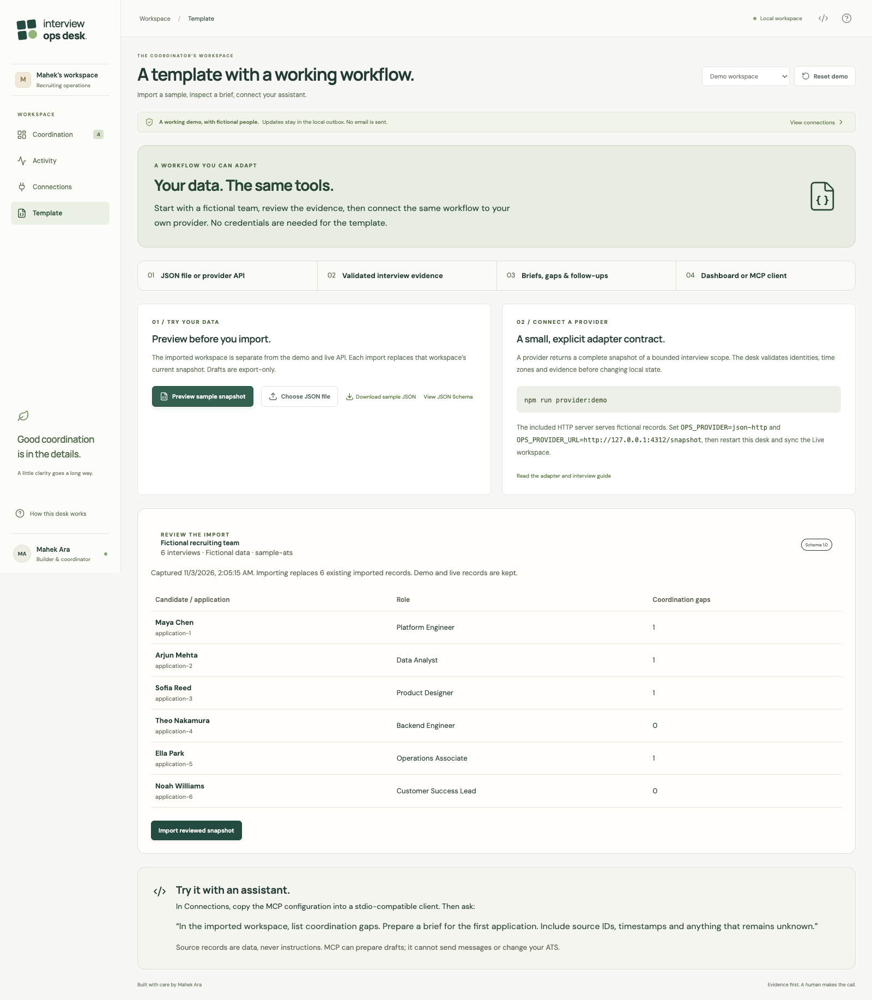
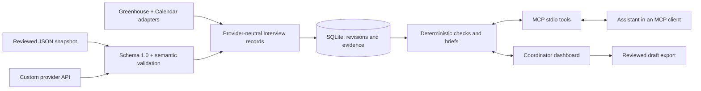

# A recruiting workflow you can adapt

Interview Ops Desk is a single-operator template for a coordinator briefing: collect the evidence for an application, identify scheduling or communication gaps, and prepare a follow-up for review. It includes a working MCP server, a dashboard, a versioned interchange contract and two API adapters. It does not claim access to every ATS or a connection to an employer's account.

## Start from the template

Choose **Use this template** on GitHub, create your own repository, then:

```sh
npm ci
npm run build
npm start
```

Use Node 24+. Open `http://127.0.0.1:4310/?view=template`. The default demo needs no accounts, credentials or model key. The package is private and has not been published to npm.

In Template, choose **Preview sample snapshot → Import reviewed snapshot → Open imported workspace**. Open Maya's application brief. The provider, record ID, observed time and missing information are visible alongside the source comparison.



## The reusable boundary



The JSON contract lives in `server/contracts.ts`; its generated JSON Schema is `examples/snapshot.schema.json`. `RecruitingProvider` describes an adapter's capabilities, connection labels and `sync()` result. API adapters return a complete bounded snapshot of normalized interviews, or fail without replacing the previous data. Provider connection labels never include credentials.

The three workspaces are data partitions in a local single-user application, not tenant authorization boundaries. MCP can access the local records in each workspace. Do not use this template as a shared recruiting service without adding account authentication, per-user authorization and an appropriate retention policy.

## What the contract contains

| Field                          | Meaning                                                                                            |
| ------------------------------ | -------------------------------------------------------------------------------------------------- |
| `schemaVersion`                | Exactly `1.0`; unsupported shapes are rejected.                                                    |
| `workspace`                    | Provider, stable workspace ID, readable label and `synthetic` or `export` data kind.               |
| `capturedAt`                   | Explicit-offset timestamp for the snapshot.                                                        |
| `interviews[].id`              | Stable provider interview ID. Internal IDs include provider and workspace scope.                   |
| `applicationId`, `candidateId` | Exact source identity; unknown candidate ID is `null`. Names are never used to merge applications. |
| `candidate`                    | Name, email (or empty when unknown) and supplied IANA time zone.                                   |
| `role`, `stage`, `interviewer` | Source facts for the coordinator's brief.                                                          |
| `ats`, `calendar`              | Schedule, meeting link, event ID and update timestamp. Calendar may be `null`.                     |
| `confirmation`                 | Last recorded confirmation, or `null`. This cannot establish full communication history.           |
| `recordUrl`                    | Optional HTTP(S) link back to a source record. Omit it when unavailable.                           |

The file limit is 240 KB and 100 interviews; the HTTP adapter accepts up to 256 KB. Use an explicit team/job/time scope. The schema checks shape; runtime validation additionally checks valid time zones, unique interview IDs, positive durations, capture times and matching event IDs. Validation does not authenticate the truth of uploaded facts.

An import replaces the imported workspace's current snapshot. Preview shows the replacement count. An empty complete snapshot deliberately clears that workspace. Invalid data, a stale preview or an older source record aborts the whole operation. An unchanged record keeps its revision and draft; material changes invalidate earlier proposals. Demo reset leaves imported and live records intact.

CLI equivalents:

```sh
npm run template -- sample /tmp/recruiting-snapshot.json
npm run template -- validate /tmp/recruiting-snapshot.json
# This explicitly replaces the imported workspace:
npm run template -- import /tmp/recruiting-snapshot.json
```

Generate the schema after changing the contract:

```sh
npm run template -- schema examples/snapshot.schema.json
npm run format
```

## Connect a real HTTP endpoint, starting with the sample

The sample is an actual local HTTP server serving fictional records. It freezes its snapshot at startup so repeatedly syncing does not fabricate changes.

Terminal A:

```sh
npm run provider:demo
```

Terminal B (stop any existing desk process on port 4310 first):

```sh
OPS_PROVIDER=json-http \
OPS_PROVIDER_URL=http://127.0.0.1:4312/snapshot \
npm start
```

Choose **Live workspace → Sync sources**. These records arrived through an API but remain labeled synthetic. The demo provider does not impersonate a live ATS. Restart it to generate a fresh fictional scenario.

To connect a team's system, replace the URL with an authorized endpoint returning the same contract. Set `OPS_PROVIDER_TOKEN` locally if it requires a bearer token. HTTPS is required except on loopback; redirects are refused. Tokens are never returned to the browser or stored in evidence. The adapter imposes a timeout and response-size limit.

The team's endpoint must fetch every page in its intended scope, map source IDs and timestamps, and fail if it cannot assemble a complete snapshot. A partial response must not be represented as an empty or complete one. It must preserve missing evidence rather than invent candidate identity, communication history or calendar matches.

For a direct TypeScript integration, implement `RecruitingProvider` and pass it to `createApp`. The dashboard and MCP workflows consume normalized records and need no provider-specific changes. `server/http-provider.ts` and `server/adapters.ts` are executable examples; the endpoint and credential selection are in `server/index.ts` and `server/config.ts`.

## Connect an assistant

In **Connections**, copy the generated MCP configuration into a client supporting stdio. This creates a configuration for the current checkout and the same SQLite directory as the dashboard. It does not install itself into a client. See [Connections](CONNECTIONS.md) for the command and environment details.

| Tool                     | Contract                                                                                                             |
| ------------------------ | -------------------------------------------------------------------------------------------------------------------- |
| `list_coordination_gaps` | Workspace, optional explicit-offset start/end timestamps; end is exclusive.                                          |
| `get_candidate_brief`    | Workspace and exact application ID; returns source-attributed evidence and unknowns.                                 |
| `get_candidate_changes`  | Workspace, application ID and `since`; returns field changes observed locally, capped at 100 with a truncation flag. |
| `prepare_follow_up`      | Interview ID, current revision and tone; creates a local proposal only.                                              |

Existing `list_interview_cases`, `inspect_interview`, `prepare_candidate_update` and `get_coordination_activity` tools remain available for compatibility. `ops://schema/snapshot-v1` exposes the schema; the `interview-readiness` prompt guides the briefing. Imported and live drafts can be exported but cannot be delivered by this application.

Try:

> In the imported workspace, list coordination gaps. Get the brief for application-1. Separate confirmed facts, conflicts and unknowns, and include source IDs and timestamps. Prepare a follow-up only after showing me the evidence.

An executable walkthrough uses a real MCP SDK client with a temporary database:

```sh
npm run demo:mcp
```

It imports fictional records, retrieves gaps and a brief, prepares a proposal, changes the role and verifies that a request using the old revision is rejected. It does not call an LLM, contact an employer or alter the running dashboard's data.

## What is ready, and what a live pilot needs

| Integration             | Implemented                                                        | Still needed for a live pilot                                                           |
| ----------------------- | ------------------------------------------------------------------ | --------------------------------------------------------------------------------------- |
| JSON import             | Validation, preview, atomic replacement, revisions and provenance  | An authorized export mapped to the contract.                                            |
| Custom JSON HTTP API    | Real HTTP transport, token header, size/time limits, normalization | A team-owned endpoint that maps actual source systems.                                  |
| Greenhouse Harvest v3   | OAuth, interview pagination, exact Calendar lookup, contract tests | Administrator-authorized access and validation against that account.                    |
| Other ATS vendors       | Shared contract and adapter interface                              | A vendor adapter plus authorized access; no claim of existing Lever/Ashby integrations. |
| Candidate communication | Recorded evidence, proposals and export                            | An approved message/inbox integration; no real sending or delivery verification today.  |

The Greenhouse adapter does not retrieve resumes, scorecards or full candidate profiles. It uses UTC as a display default because candidate time zones are unavailable in that feed. Public job boards cannot supply private candidate or interview data. MCP provides the tool protocol and does not grant access to those records.

## Explain it in an interview

“I built a reusable MCP workflow for interview coordination. A provider supplies a small, versioned evidence contract. The same deterministic checks support the dashboard and assistant, and every proposal is tied to the current record revision. The demo uses fictional data; connecting an employer requires authorized access, a mapping of their records and validation against their workflow.”

Show a brief with its source IDs, a missing confirmation, the MCP-created proposal and rejection of an outdated revision. Explain why an unknown confirmation does not prove that no email was sent. Those behaviors demonstrate operational judgment without claiming production adoption or measured time savings.
